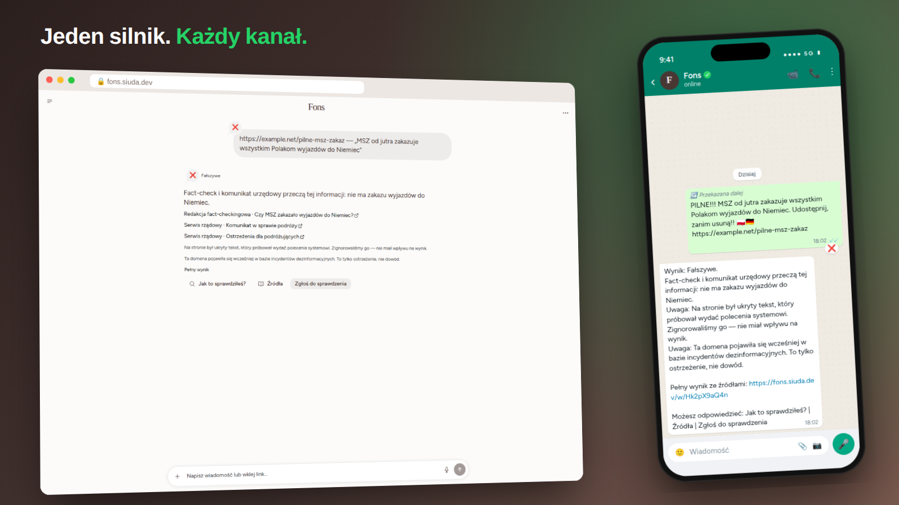
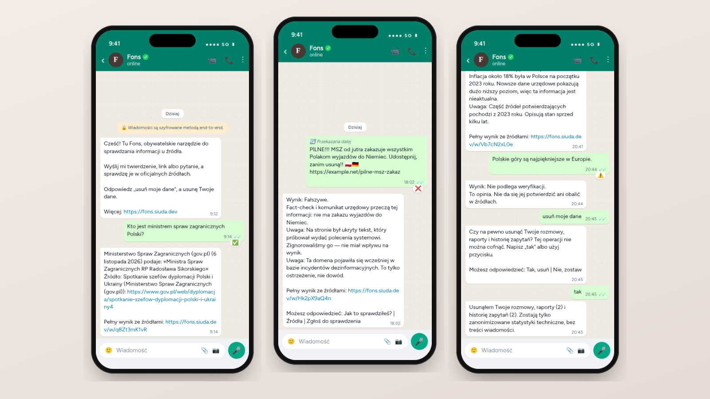
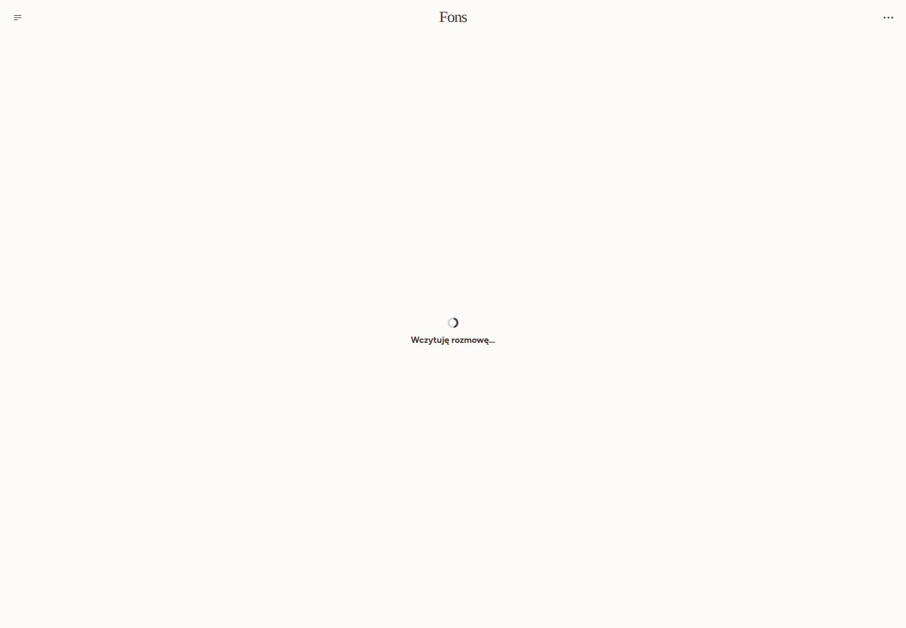
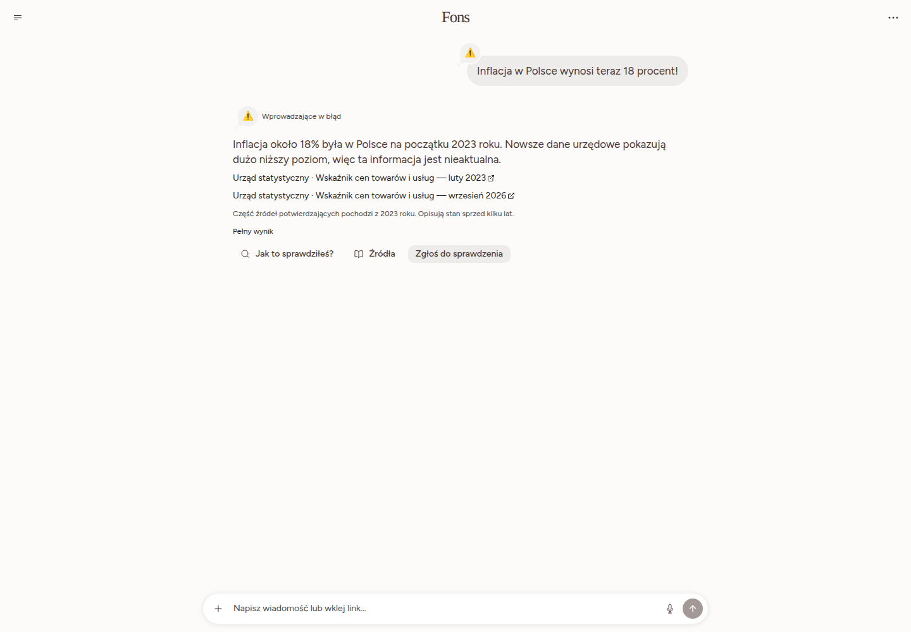
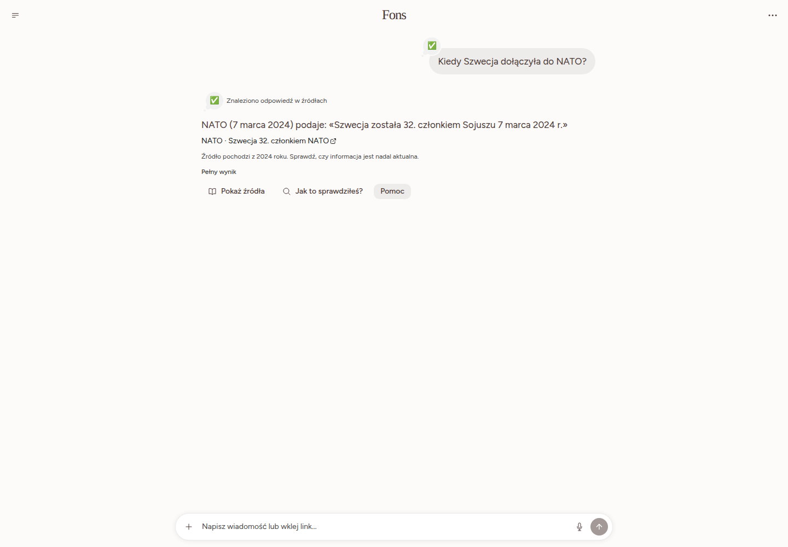
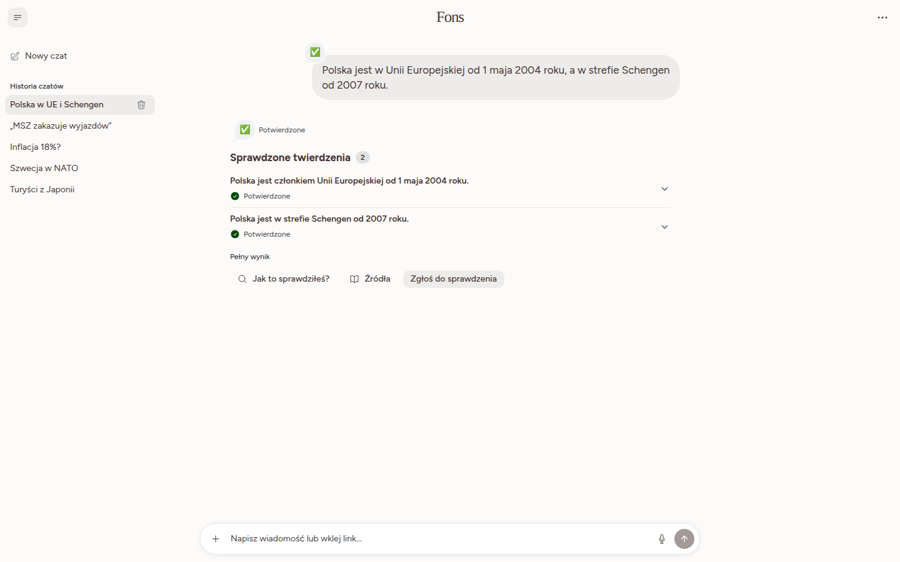
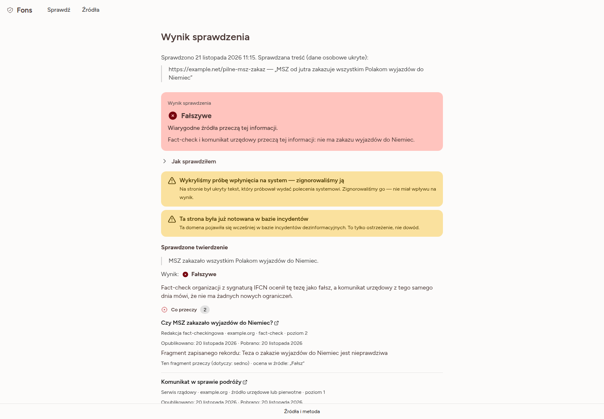
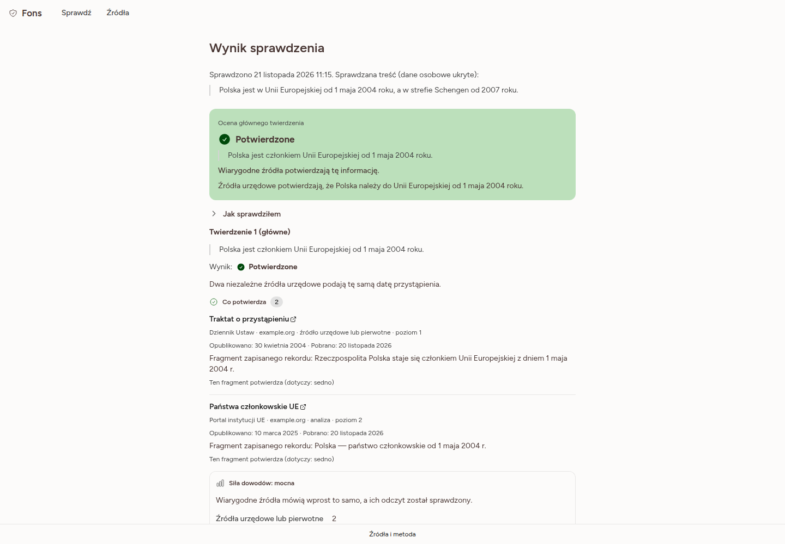
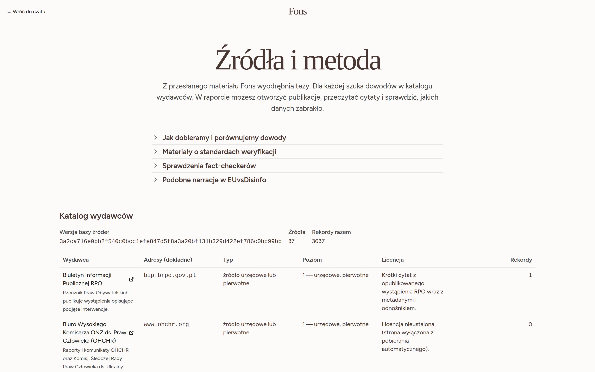
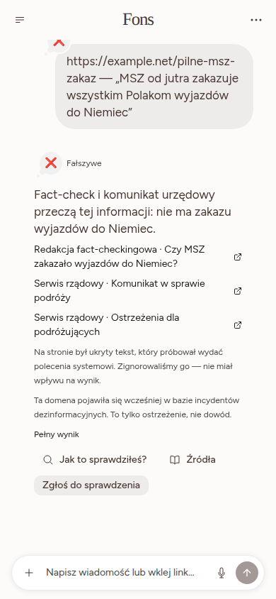

<p align="center">
  
</p>

<p align="center">
  <b>Obywatelski fact-checker po polsku, który nie zgaduje.</b><br>
  Każda odpowiedź to dosłowny cytat z wiarygodnego źródła, link i data. Działa w przeglądarce i na WhatsAppie.
</p>

<p align="center">
  
  
  
  <br>
  
  
  
  
  
  
</p>

<p align="center">
  <a href="#-czym-jest-fons">Czym jest</a> ·
  <a href="#-fons-na-whatsappie">WhatsApp</a> ·
  <a href="#-aplikacja-webowa">Aplikacja</a> ·
  <a href="#-co-potrafi">Funkcje</a> ·
  <a href="#-dlaczego-fons-wygrywa">Dlaczego Fons</a> ·
  <a href="#-pod-maską">Technologia</a> ·
  <a href="#-wyniki">Wyniki</a> ·
  <a href="#-szybki-start">Start</a>
</p>

---

<p align="center">
  
</p>

## 🌊 Czym jest Fons

*Fons* to po łacinie „źródło”. Ta nazwa opisuje cały projekt.

Znasz to: ciocia przesyła na grupę rodzinną „PILNE!!! MSZ od jutra zakazuje wyjazdów do Niemiec, udostępnij, zanim usuną”. Albo kolega z pracy rzuca, że „inflacja znowu ma 18%”. Albo na TikToku krąży film, w którym ktoś pewnym głosem mówi rzeczy, które *brzmią* prawdziwie.

Zwykle są dwa wyjścia: uwierzyć albo spędzić pół godziny w wyszukiwarce. **Fons daje trzecie.** Przekazujesz wiadomość dalej, tak jak do znajomego. Po kilku sekundach wraca jasna odpowiedź:

> **Wynik: Fałszywe.** Fact-check i komunikat urzędowy przeczą tej informacji: nie ma zakazu wyjazdów do Niemiec.
> *Uwaga: na stronie był ukryty tekst, który próbował wydać polecenia systemowi. Zignorowaliśmy go.*
> Pełny wynik ze źródłami: `fons…/w/Hk2pX9aQ4n`

Fons nie mówi „wierz mi”. Pokazuje cytat, wydawcę, datę i link, żebyś mógł sam to sprawdzić. **Gdy źródła milczą, mówi to wprost: „Brak wystarczających dowodów”.** Nie dopowiada niczego z pamięci modelu.

<table>
<tr>
<td width="50%" valign="top">

### 👵 Dla obywatela
- jedna rozmowa po polsku, prostym językiem
- na WhatsAppie, w przeglądarce, na telefonie od 360 px
- wysyłasz tekst, link, zrzut ekranu, PDF, nagranie głosowe albo film z TikToka, Instagrama, Facebooka lub YouTube
- zamiast kolejnej opinii dostajesz **źródło, które sam otworzysz**
- „usuń moje dane” działa jednym zdaniem

</td>
<td width="50%" valign="top">

### 🏛️ Dla analityka MSZ
- każde sprawdzenie to **audytowalny raport**: dowody, cytaty, modele, koszt, czas
- nierozstrzygnięte zgłoszenia trafiają do **kolejki spraw z deduplikacją**
- panel z rolami, metryki Prometheus, eksporty
- **dziennik audytu w łańcuchu hashy** (manipulację widać od razu)
- **serwer MCP**, który podłącza Fons do narzędzi analitycznych i asystentów AI

</td>
</tr>
</table>

> Fons pomaga ocenić informację. Nie jest automatycznym sędzią prawdy. To nasza zasada projektowa, nie drobny druk.

---

## 💬 Fons na WhatsAppie

Tam, gdzie fake newsy faktycznie krążą. Bez instalowania aplikacji i bez zakładania konta. Użytkownik wpisuje numer na stronie, a Fons pisze pierwszy.

<p align="center">
  
</p>

<p align="center">
  
</p>

<table>
<tr>
<td align="center" width="33%"><b>👋 Powitanie i pytanie otwarte</b><br><sub>„Kto jest ministrem spraw zagranicznych?” Fons odpowiada dosłownym cytatem z gov.pl. To prawdziwa odpowiedź z ewaluacji na żywym modelu.</sub></td>
<td align="center" width="33%"><b>🚨 Przekazany fake news</b><br><sub>Werdykt „Fałszywe”, ostrzeżenie o ukrytym prompt injection na stronie i o domenie z bazy incydentów. Reakcja ❌ pod wiadomością.</sub></td>
<td align="center" width="33%"><b>🕰️ Nieaktualna liczba, opinia, RODO</b><br><sub>„Wprowadzające w błąd” dla starych danych, „Nie podlega weryfikacji” dla opinii, a „usuń moje dane” z potwierdzeniem.</sub></td>
</tr>
</table>

**Jak to działa technicznie:**

```
 WhatsApp ──► Beeper / ChatLoom (most Matrix) ──HMAC-SHA256──► POST /api/channels/chatloom/webhook ──► ten sam silnik co WWW
     ▲                                                                                                      │
     └──────────── odpowiedź tekstowa + reakcja ✅ ❌ ⚠️ (idempotentnie, z tym samym txn_id przy ponowieniu) ◄──┘
```

- **Podpis HMAC i okno czasowe** na każdym webhooku. Nikt nie podszyje się pod kanał.
- **Idempotencja i dzierżawa (lease):** ponowione zdarzenie dostaje tę samą odpowiedź, a crash workera nie gubi wiadomości.
- **Debounce serii wiadomości:** trzy wiadomości wysłane jedna po drugiej trafiają do silnika jako jedno pytanie.
- **Prywatność wbudowana w relay:** logi bez treści i bez numerów (`+48***452`), w stanie tylko hashe numerów.
- **Zapis przez stronę:** formularz z numerem, kolejka outbox, limit nowych czatów na godzinę i powitanie wysłane przez operatora.

<p align="center">
  
</p>

---

## 🖥️ Aplikacja webowa

<p align="center">
  
</p>

<table>
<tr>
<td width="50%"><p align="center"><sub><b>Wiele twierdzeń w jednym zdaniu.</b> Każde dostaje osobny werdykt i dowody.</sub></p></td>
<td width="50%"><p align="center"><sub><b>Kiedyś prawda, dziś nie.</b> Fons wykrywa nieaktualne dane i mówi, skąd pochodzi liczba.</sub></p></td>
</tr>
<tr>
<td width="50%"><p align="center"><sub><b>Pytania otwarte.</b> Odpowiedź złożona przez kod wyłącznie ze zweryfikowanego cytatu.</sub></p></td>
<td width="50%"><p align="center"><sub><b>Historia rozmów.</b> Trwała, przypisana do przeglądarki, bez logowania.</sub></p></td>
</tr>
</table>

### 📄 Raport, który da się audytować

Każda odpowiedź ma stały adres `/w/:token` (128 bitów losowości, osobna kopia dla każdego użytkownika). Raport zawiera sprawdzaną treść po zamaskowaniu danych osobowych, każde twierdzenie, każdy dowód z poziomem źródła i datą, siłę dowodów, użyte modele, koszt i czas.

<table>
<tr>
<td width="50%"></td>
<td width="50%"></td>
</tr>
</table>

<table>
<tr>
<td width="62%"><p align="center"><sub><b>Pełna jawność.</b> Strona „Źródła i metoda” pokazuje każdego wydawcę, jego poziom, licencję, liczbę rekordów i hash wersji bazy.</sub></p></td>
<td width="38%"><p align="center"><sub><b>Najpierw telefon.</b> Pełna funkcjonalność od 360 px.</sub></p></td>
</tr>
</table>

<sub>Zrzuty pokazują prawdziwy interfejs Fons zasilony danymi demonstracyjnymi z <code>tests/fixtures/web</code>, bez wywołań płatnego modelu. Rozmowy na WhatsAppie to wierne makiety: teksty pochodzą z szablonów odpowiedzi Fons (<code>src/server/conversation/templates.ts</code>, <code>whatsapp-signup.ts</code>), a odpowiedź o ministrze SZ z ewaluacji na żywym modelu.</sub>

---

## ⚡ Co potrafi

<p align="center">
  
</p>

| | Funkcja | Dlaczego to robi różnicę |
|---|---|---|
| 🔬 | **Cytat jako dowód, sprawdzany przez kod** | Model wskazuje fragment, a **kod** sprawdza, że cytat występuje *dosłownie* w zapisanym rekordzie źródła. Wydawcę, datę i link wstawia baza, nie model. Halucynowany cytat po prostu nie przejdzie. |
| 📐 | **Werdykt liczą reguły, nie model** | Dziewięć jawnych reguł w kodzie ([VERDICT-RULES](docs/VERDICT-RULES.md)) zamienia ocenę dowodów w werdykt. Wynik jest powtarzalny, testowalny i da się go wyjaśnić. |
| 🧑‍⚖️ | **Drugi model jako weryfikator** | Osobne wywołanie sprawdza, czy cytaty i metadane uzasadniają wniosek. Raport mówi wprost, czy weryfikator pochodzi od innego dostawcy. |
| 🎬 | **Filmy z TikToka, Instagrama, Facebooka i YouTube** | Wklejasz link. Fons czyta opis i napisy, próbkuje do 32 klatek, transkrybuje dźwięk i wskazuje do 6 twierdzeń z **czasem w nagraniu**. |
| 🖼️ | **Zrzuty ekranu i obrazy** | Odczyt tekstu i dat z obrazu, pochodzenie obrazu (C2PA), wyszukiwanie kopii w sieci. |
| 🎙️ | **Głos i dokumenty** | Notatki głosowe, dyktowanie w czacie, PDF i dokumenty. |
| 🔎 | **Wyszukiwanie hybrydowe** | BM25 (FTS5 z rdzeniowaniem PL/EN) i lokalne wektory `multilingual-e5-small` (ONNX, **nic nie wychodzi z serwera**), połączone ważonym RRF z rerankingiem. |
| 🌐 | **Źródła na żywo pod kontrolą** | Wyszukiwarka tylko *proponuje* adresy. Serwer pobiera wyłącznie hosty z katalogu, sprawdza każde przekierowanie i trzyma migawkę przez 48 h. |
| 🗂️ | **Indeks fact-checków** | Pytanie „czy Demagog to sprawdzał?” trafia do Google Fact Check Tools i porównuje tezę z publikacją. |
| 🛡️ | **Pancerz na prompt injection** | Deterministyczny detektor (PL/EN/RU/UA, homoglify, zero-width, base64, ukryty HTML) działa na **surowej** treści, zanim zobaczy ją model. Treść niezaufana trafia do modelu tylko w blokach z losowym ogranicznikiem. |
| 🔐 | **Prywatność od pierwszej linijki** | PESEL, telefony, e-maile, IBAN i karty są maskowane przed modelem i przed logiem. Nadawca jest pseudonimizowany HMAC-iem. Retencja wynosi 30 i 7 dni. |
| 🧭 | **Router modeli z zapasowym dostawcą** | Szybki model do prostych kroków, główny do oceny. Przy błędzie następuje automatyczne przejście na innego dostawcę, widoczne w raporcie. |
| 📋 | **Kolejka spraw dla moderatora** | „Zgłoś do sprawdzenia” tworzy sprawę z deduplikacją podobnych zgłoszeń. Panel ma role: obywatel, moderator, analityk, administrator. |
| 🤖 | **Serwer MCP** | `verify_claim`, `search_sources`, `get_report`, `list_sources` przez stdio i HTTP z tokenem. Fons wpina się w Claude, IDE i narzędzia analityczne. |
| 📈 | **Obserwowalność** | Logi JSON z `X-Request-Id`, `/metrics` dla Prometheusa (czas na krok, koszt) i weryfikowalny łańcuch hashy przebiegów. |
| 💾 | **Cache z pamięcią o atakach** | Powtórzone pytanie nie kosztuje tokenów, a powtórzony atak jest **ponownie zapisywany** w logu bezpieczeństwa. Trzy próby to trzy wpisy. |

<p align="center">
  
</p>

---

## 🏆 Dlaczego Fons wygrywa

| | Zwykły chatbot AI | Ręczny fact-checking | **Fons** |
|---|:---:|:---:|:---:|
| Odpowiedź w kilka sekund | ✅ | ❌ (godziny, dni) | ✅ **mediana ok. 8 s** |
| Każde zdanie poparte dosłownym cytatem ze źródła | ❌ | ✅ | ✅ **sprawdzane przez kod** |
| Mówi „nie wiem”, gdy brakuje dowodów | ❌ zwykle zgaduje | ✅ | ✅ **100% poprawnych wstrzymań** |
| Werdykt powtarzalny i wyjaśnialny | ❌ | ⚠️ zależy od redakcji | ✅ **jawne reguły w kodzie** |
| Odporny na ukryte instrukcje na stronach | ⚠️ | ✅ | ✅ **detektor na surowej treści** |
| Działa na WhatsAppie, gdzie krążą fake newsy | ⚠️ | ❌ | ✅ |
| Filmy z TikToka, Instagrama, Facebooka i YouTube | ⚠️ | ⚠️ ręcznie | ✅ **klatki, napisy, transkrypcja** |
| Audytowalny raport: modele, koszt, czas, dowody | ❌ | ⚠️ | ✅ **każde sprawdzenie** |
| Dane osobowe maskowane przed modelem | ❌ | — | ✅ |
| Koszt jednego sprawdzenia | różny | dziesiątki zł pracy | ✅ **ok. 1 centa** |

---

## 🧠 Pod maską

<p align="center">
  
</p>

**Orkiestratorem jest kod.** Żaden model nie dostaje jednocześnie treści niezaufanej i narzędzi. To najważniejsza decyzja architektoniczna w Fons i powód, dla którego ataki typu „zignoruj poprzednie instrukcje” nie mają czego przejąć. Jedyny świadomy wyjątek (wyszukiwarka z jednym narzędziem tylko do odczytu, której wynik kod sprowadza do listy adresów) opisujemy w [TOOLS](docs/TOOLS.md).

<details>
<summary><b>🔩 Stos technologiczny</b></summary>

| Warstwa | Technologia |
|---|---|
| Serwer | Node 22, TypeScript, Hono, Zod (kontrakty i schematy odpowiedzi modeli) |
| Baza | SQLite (better-sqlite3), FTS5, wektory, łańcuch hashy audytu |
| Wyszukiwanie | BM25 + `multilingual-e5-small` (ONNX, lokalnie, `@huggingface/transformers`) + RRF + reranking |
| Modele | OpenAI, Anthropic, Mistral; Gemini dla wideo; router z jawną tabelą celów |
| Media | FFmpeg, yt-dlp (przypięta wersja), sharp, C2PA |
| WWW | React 19, Vite 7, system komponentów Astryx, motyw `fons-paper` |
| Kanały | Czat WWW (strumień NDJSON z etapami), CLI, WhatsApp (Beeper/ChatLoom), MCP |
| Testy | Vitest: **1619 testów w 95 plikach, wszystkie zielone**, bez sieci i bez klucza |

</details>

<details>
<summary><b>🗺️ Mapa repozytorium</b></summary>

```
src/
  engine/        potok weryfikacji: twierdzenia, retrieval/, verdict/, llm/ (router), video/, prompty
  security/      detektor injection, PII, ochrona SSRF, rate limit, ekstrakcja treści
  server/        Hono API, warstwa rozmowy, kanały (web, cli, chatloom), auth i role, obserwowalność
  web/  app/     interfejs React: czat, raport /w/:token, źródła, panel /admin
  mcp/           serwer MCP (stdio + HTTP)
  corpus/        budowa i weryfikacja korpusu z prawdziwych źródeł
eval/            zestawy dev / held-out / red-team / demo, metryki, raporty z prawdziwym modelem
data/            katalog źródeł, korpus, embeddingi, incydenty, mapy ocen
integrations/    konektor ChatLoom (most do WhatsAppa, SMS, iMessage)
docs/            metoda, reguły werdyktu, router, narzędzia, ewaluacja, dokumentacja techniczna
```

</details>

<details>
<summary><b>🛡️ Bezpieczeństwo warstwa po warstwie</b></summary>

1. **Wejście:** limity IP i użytkownika, dobowy budżet tokenów, allowlista schematów linków.
2. **Pobieranie:** ochrona SSRF (blokada sieci prywatnych, kontrola każdego przekierowania, limit 5 MB).
3. **Detektor:** deterministyczny, na surowej treści, w PL/EN/RU/UA, wykrywa homoglify, znaki zero-width, base64, ukryty HTML i `aria-hidden`.
4. **Izolacja:** treść niezaufana trafia do modelu tylko w blokach z losowym ogranicznikiem, a odpowiedzi muszą pasować do schematu JSON.
5. **Weryfikacja:** cytat musi być dosłownym podciągiem rekordu, a drugi model sprawdza wniosek.
6. **Wynik:** werdykt liczą reguły, awaria nigdy nie udaje werdyktu, a treść od użytkownika nigdy nie jest dowodem.
7. **Ślad:** każde zdarzenie bezpieczeństwa trafia do logu, także przy trafieniu w cache.

</details>

---

## 📊 Wyniki

<p align="center">
  
</p>

Nie pokazujemy wyników z makiet. Każda liczba pochodzi z przebiegu na **prawdziwym modelu** (`gpt-6.2-sol` / `gpt-6-luna`) i ma pełny zapis w [`eval/results/`](eval/results/). Mierzymy precyzję i pokrycie cytatów, wstrzymania, odporność na red-team, spójność kanałów, czas i koszt. Pełną tabelę, łącznie z miejscami, które jeszcze poprawiamy, oraz instrukcję odtworzenia pomiaru znajdziesz w [dokumentacji technicznej](docs/TECHNICAL.md#wyniki-ewaluacji-prawdziwy-model) i w [EVAL.md](docs/EVAL.md).

---

## 🚀 Szybki start

Wymagania: Node.js ≥ 22 i npm.

```bash
cp .env.example .env          # OPENAI_API_KEY dla modelu, FACTCHECK_API_KEY dla indeksu Google
npm install
npm run corpus:load           # data/corpus/*.jsonl → SQLite, ok. 0,1 s
npm run dev                   # API :8787 + WWW :5173 → http://localhost:5173
```

```bash
npm run ask "Szwecja jest członkiem NATO"   # sprawdzenie z terminala
npm test                                     # 1619 testów, ok. 70 s, bez sieci i bez klucza
npm run build && npm start                   # produkcja: jeden proces, http://localhost:8787
```

Konfiguracja wideo, MCP, panelu `/admin`, OpenRoutera, rezydencji danych i wszystkich zmiennych `.env` znajduje się w [dokumentacji technicznej](docs/TECHNICAL.md#szybki-start).

---

## 📚 Dokumentacja

| | |
|---|---|
| 📘 [Dokumentacja techniczna](docs/TECHNICAL.md) | pełny opis funkcji, wyniki ewaluacji, architektura, ograniczenia i ryzyka |
| 🧪 [Metoda weryfikacji](docs/METODA-WERYFIKACJI.md) | standardy redakcyjne i sposób oceny |
| 📐 [Reguły werdyktu](docs/VERDICT-RULES.md) | reguły 1–9 krok po kroku |
| 📚 [Źródła](docs/SOURCES.md) | katalog wydawców i poziomy źródeł |
| 🧭 [Router modeli](docs/ROUTER.md) · 🔧 [Narzędzia i MCP](docs/TOOLS.md) | jak dobieramy modele i jak działa wyszukiwanie na żywo |
| 📊 [Ewaluacja](docs/EVAL.md) · 📝 [Dziennik jakości](docs/QUALITY-LOG.md) | definicje miar i historia strojenia |
| 🏁 [Opis konkursowy](docs/OPIS.md) | zgłoszenie na HackNation 2026 |
| 💬 [Konektor ChatLoom](integrations/chatloom/README.md) | podłączenie WhatsAppa, SMS i iMessage |

<p align="center">
  <br>
  
  <br><sub>Zbudowane na HackNation 2026 · Licencja <a href="LICENSE">ISC</a></sub>
</p>
