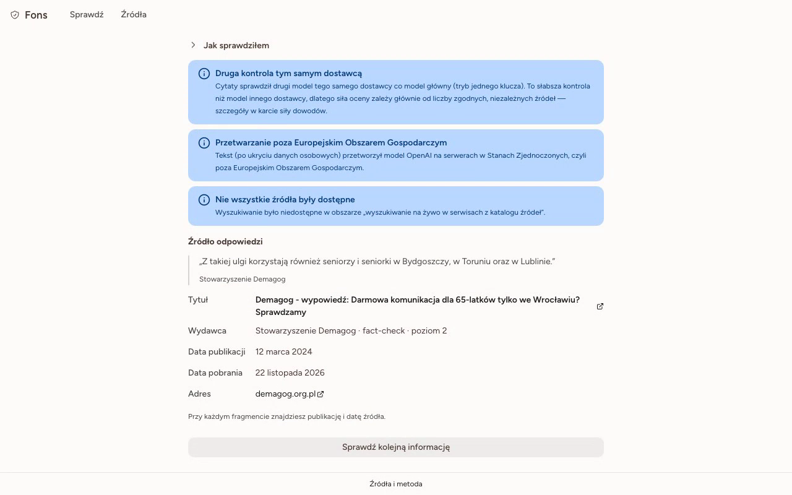
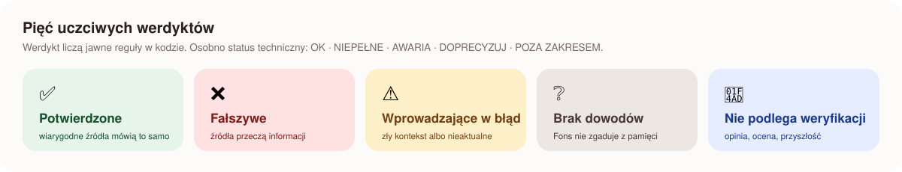
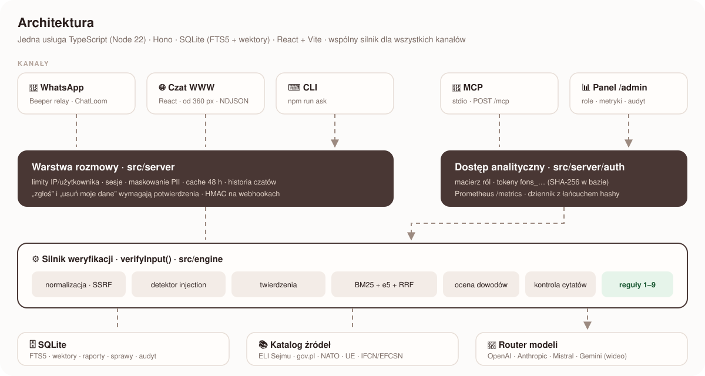

<p align="center">
  
</p>

<p align="center">
  <b>Obywatelski fact-checker po polsku ze źródłami i uzasadnieniem.</b><br>
  Sprawdź twierdzenie w przeglądarce lub przez CLI. Otwórz źródło i przeczytaj fragment, który uzasadnia odpowiedź.
</p>

<p align="center">
  

  
  <br>
  
  
  
  

  
</p>

<p align="center">
  <a href="#-czym-jest-fons">Czym jest</a> ·
  <a href="#kanały">Kanały</a> ·
  <a href="#-aplikacja-webowa">Aplikacja</a> ·
  <a href="#-co-potrafi">Funkcje</a> ·

  <a href="#-pod-maską">Technologia</a> ·
  <a href="#-wyniki">Wyniki</a> ·
  <a href="#-szybki-start">Start</a>
</p>

---

<p align="center">
  <a href="docs/konkurs/demo.mp4"></a>
</p>

## 🌊 Czym jest Fons

*Fons* to po łacinie „źródło”. Ta nazwa opisuje cały projekt.

Znasz to: ciocia przesyła na grupę rodzinną „PILNE!!! MSZ od jutra zakazuje wyjazdów do Niemiec, udostępnij, zanim usuną”. Albo kolega z pracy rzuca, że „inflacja znowu ma 18%”. Albo na TikToku krąży film, w którym ktoś pewnym głosem mówi rzeczy, które *brzmią* prawdziwie.

Na nagraniu obywatel pyta o darmową komunikację dla seniorów. Widać wyszukiwanie, odpowiedź po polsku, publikację Demagoga oraz odczyt zapisanego raportu. [Film z działania usługi](docs/konkurs/demo.mp4) · [Prezentacja](docs/konkurs/prezentacja.pdf)

Fons nie mówi „wierz mi”. Pokazuje cytat, wydawcę, datę i link, żebyś mógł sam to sprawdzić. **Gdy źródła milczą, mówi to wprost: „Brak wystarczających dowodów”.** Nie dopowiada niczego z pamięci modelu.

<table>
<tr>
<td width="50%" valign="top">

### 👵 Dla obywatela
- jedna rozmowa po polsku, prostym językiem
- w przeglądarce na komputerze i telefonie od 360 px
- wysyłasz tekst, link, zrzut ekranu, PDF, nagranie głosowe albo film z TikToka, Instagrama, Facebooka lub YouTube
- zamiast kolejnej opinii dostajesz **źródło, które sam otworzysz**
- „usuń moje dane” działa jednym zdaniem

</td>
<td width="50%" valign="top">

### 🏛️ Dla analityka MSZ
- każde sprawdzenie to **audytowalny raport**: dowody, cytaty, modele, koszt, czas
- nierozstrzygnięte zgłoszenia trafiają do **kolejki spraw z deduplikacją**
- panel z rolami, metryki Prometheus, eksporty
- **dziennik audytu w łańcuchu hashy** (manipulację widać od razu)
- **serwer MCP**, który podłącza Fons do narzędzi analitycznych i asystentów AI

</td>
</tr>
</table>

> Fons pomaga ocenić informację. Nie jest automatycznym sędzią prawdy. To nasza zasada projektowa, nie drobny druk.

---

## Kanały

Jury może sprawdzić adapter SMS bez zakładania konta i bez opłat operatora. Po konfiguracji modelu uruchom `npm run demo:sms -- "Czy Polska jest członkiem NATO?"`. Polecenie wysyła wiadomość demonstracyjną przez podpisany webhook ChatLoom, odbiera odpowiedź tekstową i zapisuje raport w tej samej bazie co WWW. Aby otworzyć link do raportu, uruchom też aplikację z tym samym `DB_PATH` i `PUBLIC_BASE_URL`. Wywołanie bez argumentów otwiera jedną rozmowę na standardowym wejściu. Każde uruchomienie rozpoczyna nową sesję. Koszt sprawdzenia przez model jest taki jak w WWW.

Czat WWW i adapter CLI prowadzą od pytania do zapisanego raportu. W teście tej samej tezy o przejazdach dla seniorów obie ścieżki wskazały tę samą publikację, ocenę i cytat. Narzędzia analityczne mogą pobierać raporty przez MCP.

Repozytorium zawiera także konektor ChatLoom/Matrix i webhook. Dostarczenie wiadomości na zewnętrzny numer wymaga uruchomionego mostu i skonfigurowanego sekretu. Instrukcja opisuje te zależności. [Konektor ChatLoom](integrations/chatloom/README.md)

## 🖥️ Aplikacja webowa

W filmie można prześledzić całe sprawdzenie w Chrome. Pokaz trwa 42 sekundy. [Obejrzyj film](docs/konkurs/demo.mp4)

## ⚡ Co potrafi

<p align="center">
  
</p>

| | Funkcja | Dlaczego to robi różnicę |
|---|---|---|
| 🔬 | **Od twierdzenia do dowodu** | W pełnym raporcie każda sprawdzona część tezy ma własny wynik i przypisane fragmenty wspierające, obalające lub uzupełniające kontekst. Kod sprawdza dosłowność cytatu w zapisanym rekordzie. Przy fragmencie znajdziesz wydawcę, datę i link. |
| 📐 | **Werdykt liczą reguły, nie model** | Dziewięć jawnych reguł w kodzie ([VERDICT-RULES](docs/VERDICT-RULES.md)) zamienia ocenę dowodów w werdykt. Wynik jest powtarzalny, testowalny i da się go wyjaśnić. |
| 🧑‍⚖️ | **Drugi model jako weryfikator** | Osobne wywołanie sprawdza, czy cytaty i metadane uzasadniają wniosek. Raport mówi wprost, czy weryfikator pochodzi od innego dostawcy. |
| 🎬 | **Filmy z TikToka, Instagrama, Facebooka i YouTube** | Wklejasz link. Fons czyta opis i napisy, próbkuje do 32 klatek, transkrybuje dźwięk i wskazuje do 6 twierdzeń z **czasem w nagraniu**. |
| 🖼️ | **Zrzuty ekranu i obrazy** | OCR, metadane, C2PA i wyszukiwanie wcześniejszych publikacji. Wybierz „Dodaj plik” → „Porównaj dwa obrazy”, żeby sprawdzić zgodność dwóch kopii lokalnie. [Zakres porównania i katalog zdjęć](data/image-references/README.md) |
| 🎙️ | **Głos i dokumenty** | Prześlij nagranie z prośbą „Przepisz nagranie” lub z twierdzeniem do sprawdzenia. Polecenie „Pokaż metadane nagrania” odczytuje lokalnie m.in. czas, kodek, częstotliwość próbkowania i liczbę kanałów. Czat obsługuje również dyktowanie, PDF i TXT. |
| 🔎 | **Wyszukiwanie wielojęzyczne** | Polskie pytanie może prowadzić do publikacji w innym języku. Odpowiedź jest po polsku, a cytat zachowuje język oryginału. Fons łączy indeks tekstowy BM25 z lokalnym modelem `multilingual-e5-small`. |
| | **Archiwum materiału** | W zakładce **Źródła** wklejasz adres, przeglądasz fragment dopuszczony do zapisu i zatwierdzasz wybór. Zapis możesz usunąć wcześniej. Po siedmiu dniach wygasa. |
| | **Rozszerzenia operatora** | Moduł wskazany przez `FONS_EXTENSIONS_MODULE` może dodać kanał wiadomości, model lub wyszukiwarkę przy starcie usługi. [Kontrakt i sposób podłączenia](docs/MODULES.md#rozszerzenia-instalowane-przez-operatora) |
| 🌐 | **Źródła na żywo pod kontrolą** | Wyszukiwarka tylko *proponuje* adresy. Serwer pobiera wyłącznie hosty z katalogu, sprawdza każde przekierowanie i trzyma migawkę przez 48 h. |
| 🗂️ | **Indeks fact-checków** | Pytanie „czy Demagog to sprawdzał?” trafia do Google Fact Check Tools i porównuje tezę z publikacją. |
| 🛡️ | **Pancerz na prompt injection** | Deterministyczny detektor (PL/EN/RU/UA, homoglify, zero-width, base64, ukryty HTML) działa na **surowej** treści, zanim zobaczy ją model. Treść niezaufana trafia do modelu tylko w blokach z losowym ogranicznikiem. |
| 🔐 | **Prywatność od pierwszej linijki** | PESEL, telefony, e-maile, IBAN i karty są maskowane przed modelem i przed logiem. Nadawca jest pseudonimizowany HMAC-iem. Retencja wynosi 30 i 7 dni. |
| 🧭 | **Router modeli z zapasowym dostawcą** | Szybki model do prostych kroków, główny do oceny. Przy błędzie następuje automatyczne przejście na innego dostawcę, widoczne w raporcie. |
| 📋 | **Kolejka spraw dla moderatora** | „Zgłoś do sprawdzenia” tworzy sprawę z deduplikacją podobnych zgłoszeń. Panel ma role: obywatel, moderator, analityk, administrator. |
| 🤖 | **Serwer MCP** | `verify_claim`, `search_sources`, `get_report`, `list_sources` przez stdio i HTTP z tokenem. Fons wpina się w Claude, IDE i narzędzia analityczne. |
| 📈 | **Obserwowalność** | Logi JSON z `X-Request-Id`, `/metrics` dla Prometheusa (czas na krok, koszt) i weryfikowalny łańcuch hashy przebiegów. |
| 💾 | **Cache z pamięcią o atakach** | Powtórzone pytanie nie kosztuje tokenów, a powtórzony atak jest **ponownie zapisywany** w logu bezpieczeństwa. Trzy próby to trzy wpisy. |

<p align="center">
  
</p>

---

## 🧠 Pod maską

<p align="center">
  
</p>

**Przebiegiem sprawdzenia steruje kod.** Modele analizujące tezę i dowody nie wykonują narzędzi. Osobna usługa wyszukiwania korzysta z narzędzia tylko do odczytu. Kod wybiera z jej odpowiedzi adresy publikacji i sprawdza je przed pobraniem. [Opis narzędzi](docs/TOOLS.md)

<details>
<summary><b>🔩 Stos technologiczny</b></summary>

| Warstwa | Technologia |
|---|---|
| Serwer | Node 22, TypeScript, Hono, Zod (kontrakty i schematy odpowiedzi modeli) |
| Baza | SQLite (better-sqlite3), FTS5, wektory, łańcuch hashy audytu |
| Wyszukiwanie | BM25 + `multilingual-e5-small` (ONNX, lokalnie, `@huggingface/transformers`) + RRF + reranking |
| Modele | OpenAI, Anthropic, Mistral; Gemini dla wideo; router z jawną tabelą celów |
| Media | FFmpeg, yt-dlp (przypięta wersja), sharp, C2PA |
| WWW | React 19, Vite 7, system komponentów Astryx, motyw `fons-paper` |
| Kanały | Czat WWW (strumień NDJSON z etapami), CLI, konektor ChatLoom wymagający konfiguracji, MCP |
| Testy | Vitest, integracje z lokalnym E5 oraz odrębne pomiary rzeczywistego silnika z dostawcą sieciowym |

</details>

<details>
<summary><b>🗺️ Mapa repozytorium</b></summary>

```
src/
  engine/        potok weryfikacji: twierdzenia, retrieval/, verdict/, llm/ (router), video/, prompty
  security/      detektor injection, PII, ochrona SSRF, rate limit, ekstrakcja treści
  server/        Hono API, warstwa rozmowy, kanały (web, cli, chatloom), auth i role, obserwowalność
  web/  app/     interfejs React: czat, raport /w/:token, źródła, panel /admin
  mcp/           serwer MCP (stdio + HTTP)
  corpus/        budowa i weryfikacja korpusu z prawdziwych źródeł
eval/            zestawy dev / held-out / red-team / demo, metryki, raporty z prawdziwym modelem
data/            katalog źródeł, korpus, embeddingi, incydenty, mapy ocen
integrations/    konektor ChatLoom (most do WhatsAppa, SMS, iMessage)
docs/            metoda, reguły werdyktu, router, narzędzia, ewaluacja, dokumentacja techniczna
```

</details>

<details>
<summary><b>🛡️ Bezpieczeństwo warstwa po warstwie</b></summary>

1. **Wejście:** limity IP i użytkownika, dobowy budżet tokenów, allowlista schematów linków.
2. **Pobieranie:** ochrona SSRF (blokada sieci prywatnych, kontrola każdego przekierowania, limit 5 MB).
3. **Detektor:** deterministyczny, na surowej treści, w PL/EN/RU/UA, wykrywa homoglify, znaki zero-width, base64, ukryty HTML i `aria-hidden`.
4. **Izolacja:** treść niezaufana trafia do modelu tylko w blokach z losowym ogranicznikiem, a odpowiedzi muszą pasować do schematu JSON.
5. **Weryfikacja:** cytat musi być dosłownym podciągiem rekordu, a drugi model sprawdza wniosek.
6. **Wynik:** werdykt liczą reguły, awaria nigdy nie udaje werdyktu, a treść od użytkownika nigdy nie jest dowodem.
7. **Ślad:** każde zdarzenie bezpieczeństwa trafia do logu, także przy trafieniu w cache.

</details>

---

## 📊 Wyniki

[Plan wdrożenia i testy odbiorcze MSZ](docs/WDROZENIE-MSZ.md) · [Krótka odpowiedź, pomiary i samoocena według kryteriów jury](docs/ODBIOR-SILNIKA.md)

Pełne odpowiedzi, wyniki według zbioru, koszt i opóźnienie znajdują się w raporcie konkursowym. Zawiera też ocenę znaczenia cytatów, próby WWW z załącznikami i wyniki działania adaptera wiadomości. [Końcowy odbiór i pakiet do odtworzenia](docs/konkurs/KONTYNUACJA.md) · [Wcześniejszy pomiar po poprawkach](docs/konkurs/WYNIKI.md) · [Pierwszy audyt](docs/AUDYT-MSZ-2026-11-22.md)

---

## 🚀 Szybki start

Wymagania: Node.js ≥ 22 i npm.

```bash
cp .env.example .env          # OPENAI_API_KEY dla modelu, FACTCHECK_API_KEY dla indeksu Google
npm install
npm run corpus:load           # data/corpus/*.jsonl → SQLite, ok. 0,1 s
npm run dev                   # API :8787 + WWW :5173 → http://localhost:5173
```

```bash
npm run ask "Szwecja jest członkiem NATO"   # sprawdzenie z terminala
npm test                                     # regresja kodu; RUN_E5_TESTS=1 włącza integracje E5
npm run build && npm start                   # produkcja: jeden proces, http://localhost:8787
```

Konfiguracja wideo, MCP, panelu `/admin`, OpenRoutera, rezydencji danych i wszystkich zmiennych `.env` znajduje się w [dokumentacji technicznej](docs/TECHNICAL.md#szybki-start).

---

## 📚 Dokumentacja

| | |
|---|---|
| 📘 [Dokumentacja techniczna](docs/TECHNICAL.md) | pełny opis funkcji, wyniki ewaluacji, architektura, ograniczenia i ryzyka |
| 🧪 [Metoda weryfikacji](docs/METODA-WERYFIKACJI.md) | standardy redakcyjne i sposób oceny |
| 📐 [Reguły werdyktu](docs/VERDICT-RULES.md) | reguły 1–9 krok po kroku |
| 📚 [Źródła](docs/SOURCES.md) | katalog wydawców i poziomy źródeł |
| 🧭 [Router modeli](docs/ROUTER.md) · 🔧 [Narzędzia i MCP](docs/TOOLS.md) | jak dobieramy modele i jak działa wyszukiwanie na żywo |
| 📊 [Ewaluacja](docs/EVAL.md) · 📝 [Dziennik jakości](docs/QUALITY-LOG.md) | definicje miar i historia strojenia |
| 🏁 [Opis konkursowy](docs/OPIS.md) | zgłoszenie na HackNation 2026 |
| 💬 [Konektor ChatLoom](integrations/chatloom/README.md) | podłączenie WhatsAppa, SMS i iMessage |
| [Eksport do OpenCTI](integrations/opencti/push.ts) | `npm run export:opencti` wysyła publiczny katalog STIX z przypisaniami DISARM do kolekcji TAXII Push i sprawdza wynik importu |

<p align="center">
  <br>
  
  <br><sub>Zbudowane na HackNation 2026 · Licencja <a href="LICENSE">ISC</a></sub>
</p>
